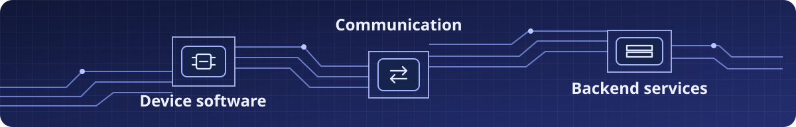

# Berkay Bakaç

**Software Engineer · Connected devices, backend systems, and field delivery**

At Statek Stabil Teknoloji, I’m the sole software developer behind products used in stores, a restaurant, and a school. I work directly with customers to define what they need and build the backend, interfaces, and device software. I own releases, monitoring, and field support.

[Engineering case studies](case-studies.md) · [Portfolio](https://berkaybakac.vercel.app/en/) · [LinkedIn](https://www.linkedin.com/in/berkay-bakac/) · [Email](mailto:berkaybakacwork@gmail.com)

## Selected work

- **[Turnstile Device Agent](case-studies.md#turnstile)** — Built Python software for **18 turnstiles across six cities** as of November 2026. Offline mode kept gates usable during a documented 10-hour outage. A FastAPI collector receives device telemetry and deduplicates retried logs.
- **[SepetArası](case-studies.md#sepetarasi)** — Built the cashier, kitchen, and pickup screens for a restaurant that completed **12,400+ orders from April through October 2026**. A display that reconnects reloads current orders so it can recover from missed updates.
- **[VeliGeldi](case-studies.md#veligeldi)** — Built the .NET backend and classroom notification software that sent **about 2,500 notifications a month** as of October 2026. A PostgreSQL test confirms that two requests cannot spend the same credit.

## More products in use

- **[AnnounceFlow](case-studies.md#announceflow)** — Built scheduled announcements and live Windows-to-Raspberry Pi audio in use at four locations as of 6 October 2026. Traced dropouts to UDP fragmentation. [Source code](https://github.com/berkaybakac/announceflow)
- **[Retail Price Checker](case-studies.md#retail-price-checker)** — Connected Android price terminals to SQL Server through a .NET API. Fixed a race that let late replies overwrite the latest scan. In use across multiple branches.
- **[Havale Bildirim](case-studies.md#bank-transfer-notifications)** — Shipped a Windows app that alerts cashiers to incoming transfers, filters duplicate transactions, and resumes pending receipt printing. First customer installation documented in November 2026.

## Applied AI and how I work

I use Claude Code and Codex daily for investigation, implementation, and review. I check the changes myself, test what happens on failure, and take responsibility for the release.

- **[Kadans & Tellal](case-studies.md#kadans-tellal) · Customer pilot** — Built a retail announcement workflow with Claude and ElevenLabs. Code controls the campaign facts and the fallback. A Go broker carries plan revisions and device presence over MQTT while devices fetch plans over HTTPS.
- **[Career Portal](case-studies.md#career-portal) · Personal project** — Built a local workflow that validates agent output, saves completed stages, and routes drafts through independent review before I approve them.

Based in Türkiye. Open to international remote work, contracting, and relocation.
