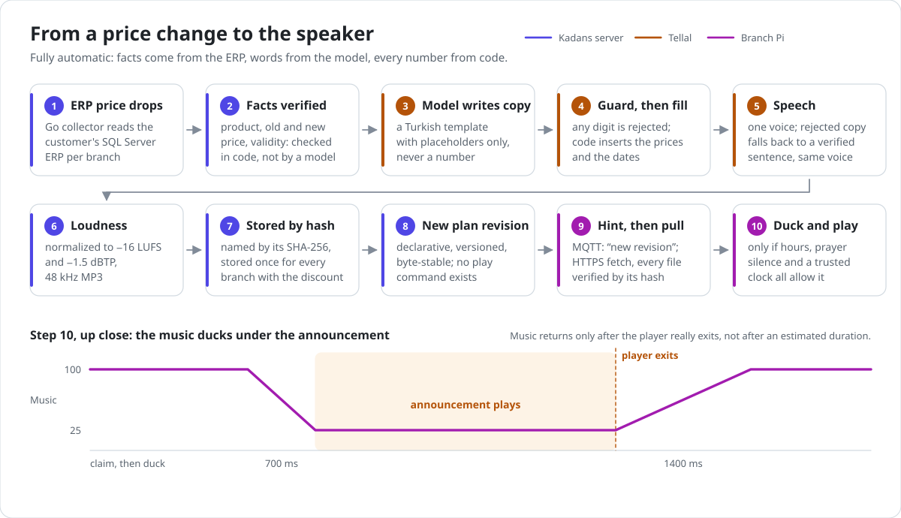

# Berkay Bakaç

**Production systems end to end: backend platforms, device fleets and AI integrations**

I design, build and run production systems, from architecture to the customer's own servers and networks. I work directly with the people who use them, integrate with the systems they already run, and own releases, monitoring and field support.

**Software Engineer**, Statek Stabil Teknoloji · December 2025 – present

[Engineering case studies](case-studies.md) · [Portfolio](https://berkaybakac.vercel.app/en/) · [LinkedIn](https://www.linkedin.com/in/berkay-bakac/) · [Email](mailto:berkaybakacwork@gmail.com)

## Selected work

### [Kadans & Tellal](https://github.com/berkaybakac/kadans-case-study)

A production system for a regional, multi-city grocery chain with 20+ branches. One HQ server on the customer's network manages promotions, music, hours and prayer silence for every branch, with in-store Raspberry Pi players rolled out in stages. I designed, built and run it end to end as sole engineer, integrated with the customer's SQL Server ERP, network and VPN, and Windows server.

- **Architecture.** Declarative, versioned plan snapshots instead of play commands; MQTT 5 hints with HTTPS as the source of truth; at-most-once playback that never replays a promotion.
- **Tellal**, an AI announcement platform I designed and built, with Kadans as its first client, integrates Claude (Anthropic) and ElevenLabs. The model writes only words around placeholders; prices and dates come from code, with prepaid balances and spending caps on every call.
- **Operations.** Signed, canary-gated releases that the customer's server installs unattended overnight, with transactional rollback; outbound-only monitoring with Prometheus and Grafana; a clean-Windows release pipeline.

<picture>
  <source media="(prefers-color-scheme: dark)" srcset="assets/kadans-dark.svg">
  
</picture>

**[Read the case study →](https://github.com/berkaybakac/kadans-case-study)** · [Design decisions](https://github.com/berkaybakac/kadans-case-study/blob/main/docs/decisions.md) · [Tellal](https://github.com/berkaybakac/kadans-case-study/blob/main/docs/tellal.md)

## Other production work

- **[Turnstile Device Agent](case-studies.md#turnstile)** · Built Python software for **18 turnstiles across six cities**. Offline mode kept gates usable during a documented 10-hour outage. A FastAPI collector receives device telemetry and deduplicates retried logs.
- **[SepetArası](case-studies.md#sepetarasi)** · Built the cashier, kitchen, and pickup screens for a restaurant that completed **12,400+ orders over seven months**. A display that reconnects reloads current orders so it can recover from missed updates.
- **[VeliGeldi](case-studies.md#veligeldi)** · Built the .NET backend and classroom notification software that sends **about 2,500 notifications a month**. A PostgreSQL test confirms that two requests cannot spend the same credit.
- **[AnnounceFlow](case-studies.md#announceflow)** · The per-store predecessor of Kadans: one installation per store, in use at four locations. Built scheduled announcements and live Windows-to-Raspberry Pi audio, and traced dropouts to UDP fragmentation. [Source code](https://github.com/berkaybakac/announceflow)
- **[Retail Price Checker](case-studies.md#retail-price-checker)** · Connected Android price terminals to SQL Server through a .NET API. Fixed a race that let late replies overwrite the latest scan. In use across multiple branches.
- **[Havale Bildirim](case-studies.md#bank-transfer-notifications)** · Shipped a Windows app that alerts cashiers to incoming transfers, filters duplicate transactions, and resumes pending receipt printing.

## How I work

I own the architecture, every decision and every release. I write decisions down with their trade-offs, prove each guarantee with a test that fails without it, and verify on the target system. I use Claude Code and Codex daily as coding agents under my approval gates and test-enforced repository rules, and I own the correctness of every change.

Based in Türkiye. Open to international remote work, contracting, and relocation.
